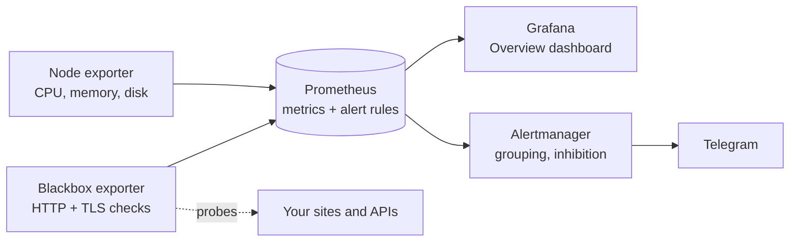

# Monitoring stack

Uptime checks, TLS expiry, server metrics, dashboards and Telegram alerts in one
`docker compose up`. Know your site is down before your customers do.

Maintained by [GonService](https://gonserviceit.com.br/devops) · [Português](#em-português)



## What you get

| Component | Version | Role |
| --- | --- | --- |
| Prometheus | 2.54.1 | Scrapes metrics every 30 s, evaluates alert rules, keeps 30 days |
| Blackbox exporter | 0.25.0 | Checks each URL in [`targets/http.yml`](prometheus/targets/http.yml): status, latency, TLS expiry |
| Node exporter | 1.8.2 | CPU, memory, disk and filesystem metrics of the host |
| Alertmanager | 0.27.0 | Groups alerts, suppresses noise, sends to Telegram (resolved too) |
| Grafana | 11.2.2 | Provisioned data source and [Overview dashboard](grafana/dashboards/overview.json): status, response time, uptime, TLS days left, CPU, memory, disk |

### Alerts

| Alert | Fires when | Severity |
| --- | --- | --- |
| SiteDown | HTTP check fails for 2 minutes | critical |
| SiteSlow | Average response time above 2 s for 5 minutes | warning |
| TLSCertificateExpiringSoon | Certificate expires in less than 14 days | warning |
| TargetDown | A monitored component stops responding | critical |
| HighCPU / HighMemory | Above 90% for 10 minutes | warning |
| DiskAlmostFull | Less than 10% free | critical |
| DiskWillFillIn24h | Current trend fills the disk within a day | warning |

Rules have unit tests ([`prometheus/tests`](prometheus/tests/alerts.test.yml)) run by `make check`
and in CI. A site that is down does not also page you for being slow (inhibition rule).

## Run it

```bash
make init    # creates .env and secrets/telegram_bot_token
# edit .env: GRAFANA_ADMIN_PASSWORD and TELEGRAM_CHAT_ID
# put the bot token (from @BotFather) in secrets/telegram_bot_token
make up      # Grafana on http://localhost:3000
```

- **Monitor your URLs:** edit [`prometheus/targets/http.yml`](prometheus/targets/http.yml); Prometheus
  picks up the change within a minute.
- **More servers:** run node-exporter on each one and add it to the `node` job in
  [`prometheus.yml`](prometheus/prometheus.yml), then `make reload`.
- **Without Telegram:** until `TELEGRAM_CHAT_ID` and the bot token are set, Alertmanager starts with
  [`alertmanager.yml`](alertmanager/alertmanager.yml) and alerts only show in Alertmanager and Grafana.
- **Slack or e-mail instead of Telegram:** replace the receiver in
  [`telegram.yml`](alertmanager/telegram.yml) with `slack_configs` (`api_url_file`) or
  `email_configs` (`auth_password_file`), keeping secrets in the `secrets/` folder.
- **Ports** are bound to `127.0.0.1`. To expose Grafana, put it behind a reverse proxy with HTTPS.

## Em português

Monitoramento completo com um `docker compose up`: verificação de disponibilidade e tempo de resposta
dos seus sites e APIs, aviso de certificado TLS vencendo, métricas de CPU, memória e disco, painel no
Grafana e alertas no Telegram. As regras de alerta têm testes automatizados. Para usar: `make init`,
preencha o `.env` e o token do bot, e `make up`.

Quer monitoramento e alertas no seu sistema? A GonService instala e mantém:
[gonserviceit.com.br/devops](https://gonserviceit.com.br/devops) ·
[contato@gonserviceit.com.br](mailto:contato@gonserviceit.com.br)

## License

[MIT](LICENSE)
